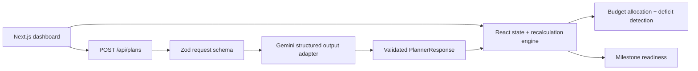

# PlanOdyssey

PlanOdyssey is an event command center for celebrations that need more than a static checklist. It keeps budget allocations, guest-driven cost pressure, vendor quotes, and milestone readiness in one reactive workspace.

## Phase 1 — architecture and data flow



The core state is defined in `lib/types.ts`: `PlannerState` contains event identity, guest count, budget, spent amount, budget categories, milestones, and vendor quotes. `PlannerResponse` is the strict response envelope for AI-backed planning operations. `lib/planner-engine.ts` owns deterministic cascading mutations so changes remain instant even when an AI request is unavailable.

## Phase 2 — backend and AI boundary

`app/api/plans/route.ts` validates event inputs and validates Gemini's structured JSON response before returning it. The existing `app/api/plan/route.ts` remains the lightweight legacy planner endpoint.

## Phase 3 — frontend

The dashboard in `app/page.tsx` includes responsive navigation, a readiness overview, live budget pulse, milestone tracker, vendor shortlist, insight card, and a mutation drawer. Budget and guest edits immediately recalculate projected spend and update risk styling without a refresh.

## Phase 4 — edge cases

1. **Budget deficit after a mutation:** values are clamped to safe minimums, projected spend is recomputed from categories, and the UI changes to an explicit “Needs attention” state rather than hiding the deficit.
2. **Invalid or malicious API input:** the route rejects malformed JSON fields, guest counts outside `1..5000`, and budgets outside the supported range with a structured 400 response.
3. **AI/provider unavailability:** deterministic local recalculation remains authoritative for interactive changes, so the dashboard stays useful without depending on a live model round-trip.

## Run locally

```bash
npm install
npm run dev
```

The chatbot uses the server-side `/api/chat` proxy. It sends conversation history to Gemini Flash using `GEMINI_API_KEY` or `GOOGLE_API_KEY` from `.env`; the browser never asks for or receives the key. The Create Plan flow uses `/api/plans` to generate validated location/date-aware recommendations, budget categories, applicable risks, and a completion wish.

## Planner reliability and analytics

This repository does not contain a FastAPI service at `127.0.0.1:8000` or a `/api/v1/planner/generate` route. The active planner path is the browser `Create Plan` flow → `POST /api/plans` → Gemini REST API, with the legacy `POST /api/plan` route still available for its smaller response schema.

The previous planner path had no bounded retry policy, swallowed provider/network details, and treated every provider response as a one-shot request. It also used a separate legacy SDK path with deterministic fallback text. The current path uses the same `GEMINI_MODEL` configuration as the server-side integration, a 12-second timeout, three attempts with exponential backoff and jitter, `Retry-After` support, retry-only transient status handling, request IDs, duration/status logs, and Zod validation. Missing credentials, permanent provider errors such as an unsupported model, timeouts, and malformed responses are returned as explicit errors; failed requests never become fabricated plans.

The dashboard analytics are derived from the current plan's allocation total, target budget, guest count, and optional estimated-spend field. Editing allocations updates the cards and charts immediately. Validation checks required fields, numeric values, negative allocations, and over-budget totals; over-budget plans remain visibly marked with a warning rather than being presented as compliant. Drafts can be saved locally, restored from the last validated plan, and displayed in INR or USD. No timeline spending series is shown because the current response schema does not provide dated spending data.

Google sign-in uses the server-only `GOOGLE_CLIENT_ID`, `GOOGLE_CLIENT_SECRET`, and `GOOGLE_REDIRECT_URI` variables. Add the callback URL to the Google Cloud OAuth web application before testing. Account registration and Google account linking persist hashed local account records in the local `planodyssey.accounts.json` database file, which is ignored by Git.

The account modal supports username/password login, new-user registration, CAPTCHA-style challenge validation, and email OTP sign-in. Wrong credentials return a direct login error with a registration path.

## Product flows

- **Workspace navigation:** Overview, Budget, Guests, Vendors, Timeline, and Documents now render distinct working views instead of dead buttons.
- **Profile:** Sign in/register uses an email format guard, a six-digit OTP flow, and Nodemailer when SMTP variables are configured. Without SMTP, development mode visibly returns a demo code in the modal.
- **Demo payment wall:** The AI concierge includes a clearly labeled, non-chargeable Indian payment-style wall with UPI/QR, card, wallet, and net-banking presentation. Access expires after 180 seconds. It does not collect or process real payment credentials.
- **AI concierge:** `/api/chat` sends the user's conversation to Gemini Flash when configured and explicitly distinguishes estimates from facts requiring live verification.
- **Create plan:** Collects event name/type/date, budget, confirmed and uncertain guests, and location. After AI output is validated, the dashboard applies the suggested allocation and starts a days/hours/minutes/seconds countdown.
- **Settings and support:** Theme, reminders, sign out, profile, contacts, feedback, and improvement surfaces are included.

For production authentication, move OTP storage and verification to a database or managed identity provider, hash codes, add rate limiting, and never return `demoCode`.
